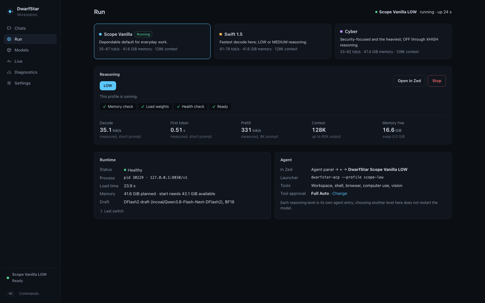
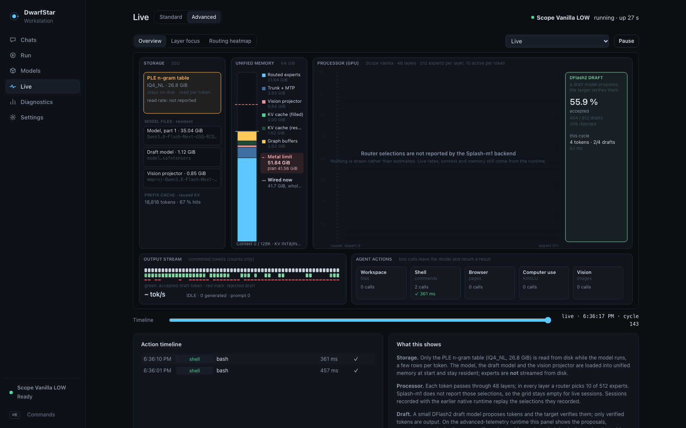

# DwarfStar

A local workstation for running large mixture-of-experts language models as coding agents on one Apple-Silicon Mac. DwarfStar runs three 48-layer Qwen3.8-Flash-Next-family models (512 experts, 10 active) at 2.25 bits per expert weight on a 64 GiB M1 Max, with speculative decoding (a DFlash2 draft model), a disk-backed n-gram embedding table, vision, a 128K context, and a full agent tool stack in Zed.



## Models

| Model | Reasoning | Context | K / V cache | Default |
|---|---|---:|---|---|
| **Scope Vanilla** — the published GSQ-RCO Q2_0 build of Qwen3.8-Flash-Next | LOW | 128K | INT8 / INT8 | yes |
| **Swift 1.5** — Swift 1.5 fine-tune, same recipe, its own routers, MTP head and tokenizer | LOW, MEDIUM | 128K | INT8 / INT8 | no |
| **Cyber** — format conversion of the pinned Dealign CYBERSECURITY NVFP4 checkpoint | OFF, LOW, MEDIUM, XHIGH | 128K | INT8 / INT8 | no |

Seven profiles, one per model × reasoning effort. Context is a model property; there are no context variants. All three run one shared runtime policy; Cyber's only override is a 1024-token prefill chunk (instead of 2048), required to keep its 128K plan under the GPU's Metal working set. Details and measured numbers: [docs/MODELS.md](docs/MODELS.md).

## What is in the box

* **One Workstation** (`DwarfStar Workstation.app`): pick a model and a reasoning level, start/switch/stop with memory admission and visible stages, per-model statistics, live telemetry, a compute visualizer with per-request history, and diagnostics with health checks and crash recovery.
* **One controller** that only ever runs one model, refuses unpinned binaries or model files, and checks each model's own memory plan before loading.
* **Chats** in the Workstation: durable conversations with pins, stars, tags, forks and Markdown/JSON export that run through the same agent (tools, automatic compaction) and stay on your Mac.
* **One agent launcher** for every profile: `bin/dwarfstar-acp --profile <id>` (ACP, workspace/shell/browser/computer-use/vision tools, compaction, recovery) with three approval presets: Ask, Workspace Auto and Full Auto.
* **One runtime** for all three models: Splash-m1 1.6.1-m1 with two DwarfStar patches (`splash-m1-1.6.1-ds1`: Swift's tokenizer profile, exact BF16 planes for Cyber), with DFlash2 speculative decoding, an INT8 KV cache and a prefix cache. It is faster and leaner than the earlier native ds4 runtime on every model, with the same answers, so native is retired: its behaviour is recoverable from git for comparison, not installed as a second runtime ([docs/BACKENDS.md](docs/BACKENDS.md)).
* **Real telemetry**: the runtime's own measurements — request counts, time to first token, inter-token latency, prefill and decode rates, draft acceptance, prefix-cache hits, context occupancy, memory and thermal state — plus the agent's tool actions, produced only while someone is watching. Splash does not expose per-token router, expert or PLE activity; the Live and Visualizer views label those regions "not reported" rather than estimate them.



## Quick start

```bash
cp config/local.example.json config/local.json      # point data_root at your model data
(cd agent-tools && npm ci)
bin/dwarfstar generate && bin/dwarfstar assets
scripts/validate/check.sh                            # no model is loaded
python3 app/workstation/build.py --bundle "$HOME/Applications/DwarfStar Workstation.app"
bin/dwarfstar zed --apply                            # seven Zed agent entries
```

Model weights are not in this repository. See [docs/REPRODUCIBILITY.md](docs/REPRODUCIBILITY.md).

## Documentation

| | |
|---|---|
| [Architecture](docs/ARCHITECTURE.md) | Layers, code and data roots, ports |
| [Models](docs/MODELS.md) | The three models, their pins, memory and measured performance |
| [Workstation](docs/WORKSTATION.md) | Views, profiles, memory admission, shared Zed sessions, building the app |
| [Sessions](docs/SESSIONS.md) | Shared Workstation/Zed conversations: the canonical store, one writer, limits |
| [Visualizer](docs/VISUALIZER.md) | Live's Advanced view: what each region shows and where it comes from |
| [Benchmarks](docs/BENCHMARKS.md) | Results, how they were measured, the production validation |
| [Backends](docs/BACKENDS.md) | Splash-m1, the one runtime; native and MLX as history; prefill chunk and prefix reuse |
| [Draft models](docs/DRAFT-MODELS.md) | The shared DFlash2 draft, measured acceptance per model, whether a matched draft is worth building |
| [Advanced telemetry](docs/ADVANCED-TELEMETRY.md) | The ds2 runtime's per-cycle DFlash channel: what it reports, overhead, build identity, rollback |
| [Native retirement](docs/NATIVE-RETIREMENT.md) | How native was retired and how to reconstruct it from Git |
| [Cyber conversion](docs/CYBER-CONVERSION.md) | NVFP4 → DwarfStar, fidelity and limitations |
| [Storage](docs/STORAGE.md) | The five roots, disk use, the 2026-11 consolidation, safe cleanup |
| [Research history](docs/RESEARCH-HISTORY.md) | How it was built, with dates |
| [Reproducibility](docs/REPRODUCIBILITY.md) | Code → runtime → assets → data, pins, rebuilding |
| [Development](docs/DEVELOPMENT.md) | Setup, validation, changing the catalog |
| [Demo](docs/DEMO.md) | A ten-minute walkthrough |

## Status

Production: Scope Vanilla LOW is the default. Swift and Cyber are selectable alternatives. Known limitations are listed in [docs/known-limitations.json](docs/known-limitations.json); the most important are that Splash reports requests, rates, context and memory but not per-token router, PLE or draft activity (the Visualizer says so instead of drawing those regions), and that Cyber's 2-bit expert encoding occasionally produces a broken first turn.

## Licence

MIT (`LICENSE`). Upstream components and model licences: `THIRD_PARTY_NOTICES.md`. No model weights are included.
