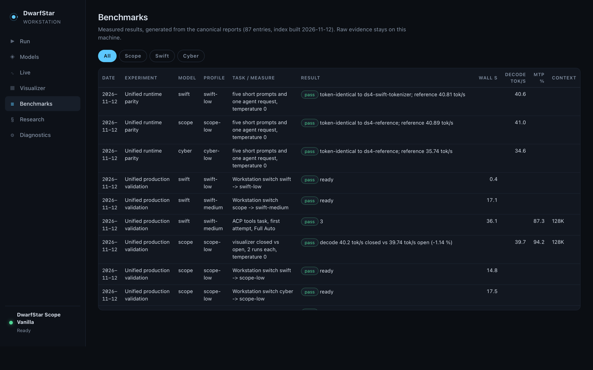

# Benchmarks

All results come from the canonical reports on the reference machine (M1 Max, 64 GiB) and are collected into `research/benchmark-index.json` by `dwarfstar bench-index` (87 entries). The Workstation's **Benchmarks** view renders the same index. Raw evidence stays outside the repository.



## How to read them

* **One natural attempt.** Agent tasks are scored on the first attempt with frozen validators; no repair, retry or fallback unless stated.
* **Timing.** Load, time to first token, prefill, decode and task wall measure different intervals and are never added. Client-measured decode on long answers includes reasoning tokens.
* **MTP acceptance** is the share of drafted tokens accepted by the main model.
* **Not measured** means not measured; nothing is estimated.

## Production validation (2026-11-12)

The release's own runtime pass, driven through the product (Workstation switch, `dwarfstar-acp`, live telemetry): `scripts/validate/production_validation.py`. **15 of 15 passed.** Ten model sessions in total.

| Profile | Check | Result | Wall | MTP |
|---|---|---|---:|---:|
| scope-low | ACP tool task (shell + write), first attempt, Full Auto | pass, 0 approval prompts | 35.6 s | 93.8 % |
| swift-medium | ACP tool task, first attempt, effort `medium` on the wire | pass | 36.1 s | 87.3 % |
| cyber-low | short prompt at 128K | pass, 36.2 tok/s | – | 95.0 % |
| cyber-low | needle over a 59,471-token document | pass, prefill 288 tok/s | 230 s | 82.6 % |
| cyber-low | needle over a 120,399-token document | pass, prefill 278 tok/s, peak wired 52.94 GiB | 454 s | 88.5 % |
| cyber-low | ACP tool task with the visualizer open | pass | 47.4 s | 90.8 % |
| cyber-low | factual, first attempt | pass | 30.5 s | 90.9 % |
| cyber-low | coding fix (tests must pass), first attempt | pass | 92.6 s | 85.6 % |
| cyber-low | security source review (SQL injection, path traversal), first attempt | pass | 70.9 s | 79.8 % |
| scope-low | visualizer overhead: closed vs open, 2 runs each | −1.1 % decode, identical output (not material) | – | 94.2 % |

Switching through the Workstation lifecycle:

| From → to | Result | Wall |
|---|---|---:|
| idle → Cyber LOW | ready | 2.5 s |
| Cyber → Scope LOW | ready (Cyber stopped first) | 17.5 s |
| Scope → Swift MEDIUM | ready | 17.1 s |
| Swift MEDIUM → Swift LOW | ready, **no restart** | 0.4 s |
| Swift → Scope LOW | ready | 14.8 s |

Every agent session produced real router, MTP, PLE and tool telemetry on the event stream.

**Cyber 128K.** The earlier 128K attempt failed at the second prefill chunk with a Metal out-of-memory error because the plan (51.92 GiB with the vision projector) exceeded the 51.84 GiB working-set limit. Prefilling in 1024-token chunks lowers the plan to 50.81 GiB; both depth tests then passed. No model weights changed.

**Q8 KV.** Requested for this release and not available: the runtime's Qwen4Exp graph allocates and reads K/V only as F16. All three models run F16 K/V.

## Earlier results (summary)

| Result | Model | Source |
|---|---|---|
| Unified runtime token-identical to the reference builds (5 prompts + 1 agent request each) | all | runtime parity 2026-11-12 |
| Swift MEDIUM 8/8 frozen low-risk tasks vs LOW 6/8, +6.9 % total wall | Swift | MEDIUM rematch 2026-11-11 |
| Scope wins the quality-first matched comparison against Swift LOW | Scope, Swift | 2026-11-01 |
| Native adaptive MTP +5.34 % median decode | Scope | decode/MTP audit 2026-11-11 |
| ~95 % of warm agent time is native inference | Scope | latency decomposition 2026-11-03 |
| Opening-token probe: early stops 4/80 (Cyber), 0/80 (Scope, Swift) | all | 2026-11-12 |
| Cyber agent and tool validation: all tools, 2 of 21 sessions needed a retry | Cyber | 2026-11-12 |

Regenerate and check the index:

```bash
bin/dwarfstar bench-index
bin/dwarfstar bench-index --check
```
