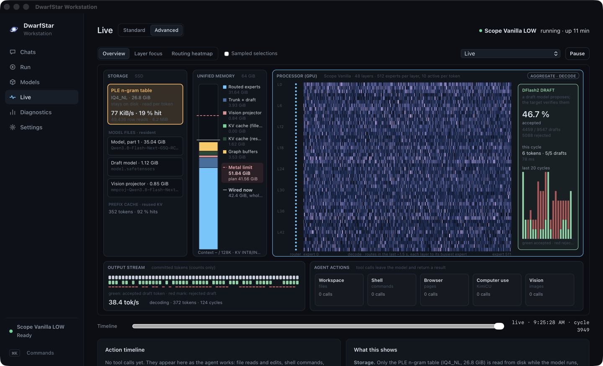
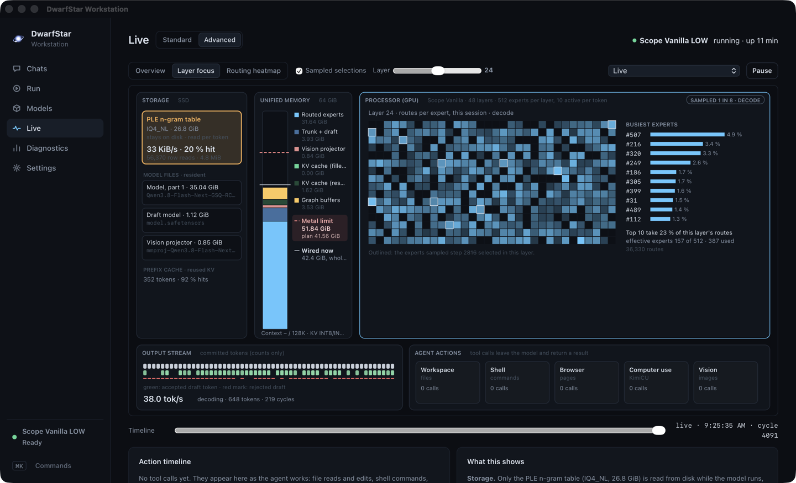
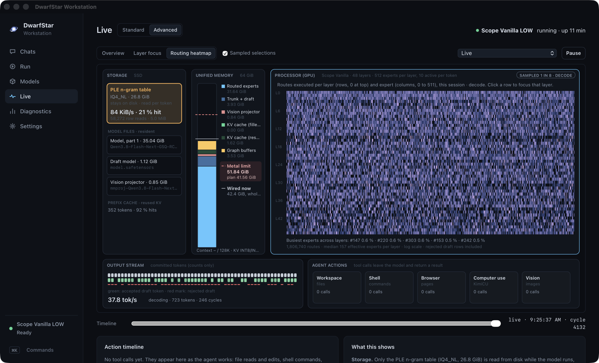
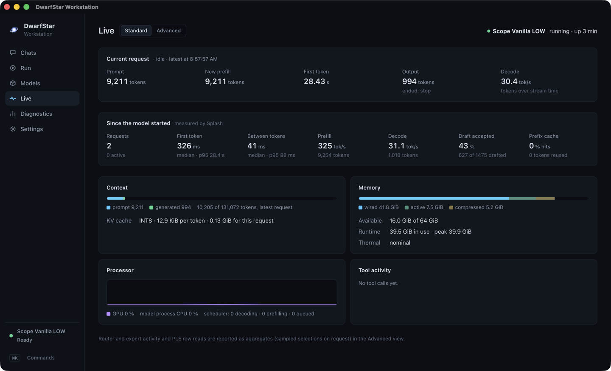

# ds3 GPU telemetry

**Status: production candidate.** `config/runtime-policy.json` names `splash-m1-1.6.1-ds3-gpu-telemetry` (ds3) on this
branch; `main` still names ds2 until this merges. ds3 is built from the same pinned Splash source (`1.6.1-m1`, commit
`5312c54`) with the ds1 and ds2 patches plus `backends/splash-m1/patches/ds3/`. ds2's binaries, hashes, patches and
manifests are untouched and it stays pinned as the rollback. The native backend is not restored: no ds4 runtime,
backend selector, control socket, log parser, native server or F16 KV runtime. The old native code was read only as a
reference for signal definitions and Visualizer semantics.

Rollback: set `config/runtime-policy.json` `model_defaults.runtime` to `splash-m1-1.6.1-ds2-telemetry` →
`dwarfstar generate` → restart the service and model. Exercised once through the installed app (§10).

## 1. The old telemetry contract, and what Splash can recover

The native runtime (`native/telemetry/ds4_telemetry.h`, `docs/VISUALIZER.md` at tag `rollback/native-default-20261113`)
reported per verify cycle, at level 1 counters (tokens, MTP drafts, n-gram disk reads) and at level 2 also the router's
selected experts with weights for up to 4 rows per layer, read back from the GPU each cycle. The hub folded row 0 into a
session layer × 512 heat map. ds2 already restored the cycle counters (as DFlash2) and request timing; this table is the
rest.

| Old signal | Meaning | Native source | Splash equivalent | Exact recovery possible? | Aggregate possible? | Likely overhead | ds3 implementation |
|---|---|---|---|---|---|---|---|
| Router selections (`tick.r`, level 2) | The 10 of 512 experts each layer chose for the current token | `ds4_tm_cycle_end(selected, …)`: GPU read-back each cycle, rows 0–3 | `scratch.selectedExperts`: GPU-private, overwritten by every layer, read by the MoE grouping kernel | Yes, by copying row 0's ids in the grouping kernel each step (480 words/step) | — | Copy: 10 stores per layer per sampled step; host reads a ring | **Sampled** (1 decode step in N, default 8) and research **Exact** (every step) into a 64-slot ring in a Shared page; row 0 only, no weights |
| Router weights | Each selection's gate weight (drawn as alpha) | same read-back, `weights[]` | separate weights buffer the combine reads | Possible, another 480 floats/step | — | as above | **Not implemented**: no ds3 view needs it; reported as unavailable |
| Router rows 1–3 | Selections of the speculative rows of a verify cycle | `DS4_TM_ROWS 4` | the verify rows the grouping kernel counts | Yes, at 4× the copy | — | 4× the sample copy | Counted in the **aggregate** (every executed row); not sampled |
| Routing heat map | Session counts per layer × expert | hub, from row 0 of observed ticks (only while a level-2 viewer was attached) | the grouping kernel's per-expert route count (threadgroup `counts[e]`) | — | **Yes, exactly**: every route executed, per phase | One conditional global add per owner thread with a non-zero count | **Aggregate**: `[phase][layer][expert]` uint32 histogram in the page; reader takes differences |
| Expert utilisation / concentration | Hot experts, spread of routing | derived from heat | derived from the aggregate | — | Yes | none on the GPU | Workstation derives top-10 share and effective experts (exp of entropy) per layer |
| PLE (n-gram table) reads | Rows read from the SSD per token | `ds4_tm_ple_read(bytes)` per read | the streamed row store's `SparseRowStats` (requested, unique, cache hits, SSD reads, bytes, evictions, prefetch, latency p50/p95) | Per stage only by instrumenting the store; not needed | **Yes**, the store's own counters | none added: reads existing counters | **PleAggregate** event, per-poll deltas (≥ 450 ms apart) |
| Expert cache hit/miss, streamed expert reads | Experts loaded from the SSD | native kept experts resident | `ExpertStoreStats` when `--expert-memory` streams (loads, routed, read, prefetched, read bytes, resident, slots) | — | Yes, when streaming | none added | In **PleAggregate** as `experts{…}`; `expert_storage: resident` when every expert is in memory |
| MTP drafts proposed/accepted per cycle | Speculative decode | `ds4_tm_cycle_drafts` | DFlash2 verify cycle | — (ds2) | — | — | ds2 `decode_cycle`, unchanged (MTP maps to DFlash2; no MTP panels are faked) |
| Tokens per cycle | Committed tokens | cycle end | `decode_cycle.output` | ds2 | — | — | unchanged |
| Context, KV checkpoints | Occupancy, disk cache | ticks, server log | `/status` context and prefix cache | ds2 | — | — | unchanged (`via_status`) |
| Request rows | Start/finish per request | server log stream | none per request in Splash | — | — | — | ds2 request history (decode runs), unchanged |
| Detail-level heartbeat | 0 nobody, 1 live, 2 visualizer; 3 s TTL | UDP control port | `/telemetry?level=` poll, 3 s TTL | — | — | — | Levels 2 Advanced (aggregates), 3 Sampled, 4 Exact (research, never proxied by the Workstation); each level now lapses on its own |
| Calibration capture | Offline expert-input moments | `DS4_QWEN4_CALIB_DIR` | — | out of scope (not telemetry) | — | — | — |

What is *not* recovered: router weights, per-token PLE reads, and per-token selections at full rate in the default
modes. The Workstation labels every routing view as aggregate or sampled and never presents either as exact.

## 2. Design: aggregate on the GPU, read a small page without waiting

* **Hook.** Splash's MoE grouping kernel (`moe_group_routes*`, one threadgroup, thread *e* owns expert *e*) already
  counts each step's routes per expert in threadgroup memory to build its tiles. ds3 binds one extra buffer, the
  *telemetry page*, and one parameter word (`MoeGroupParams::telemetry`: 0 = no page, else 1 + layer, + 1<<16 for
  prefill). Nothing about routing is recomputed, no logits or index tensors are copied, and the routing the kernel
  produces is unchanged: the telemetry code only reads `counts[e]` and `selected[]` after the kernel has them.
* **Page** (`runtime/ops/MoeTelemetry.hpp`, layout in `runtime/metal/abi/MoE.h`): one Shared-storage buffer, allocated
  once at the first graph build, never resized. Header (magic `DS3T`, version, mode, sample period, layers, experts,
  top-k, per-phase step counters, samples-written counter), a `[2 phases][64 layers][512 experts]` uint32 histogram, and
  a 64-slot sample ring of `[step, layers written, period, 64 × 16 ids]`. **525,120 bytes.** Models past its bounds (more than
  64 layers, 512 experts or top-16) get no page and run exactly as without ds3.
* **Modes** are one host-visible word the kernels read: 0 off (each owner thread reads one word and stops), 1 aggregate,
  2 sampled (also copy row 0 of one decode step in N), 3 exact (every step). A `/telemetry` poll sets it from the
  highest level any consumer polled within the last 3 s; with no poll for 3 s the engine sets it back to 0. Setting a
  mode is two plain stores into Shared memory — no command, no encoder, no wait.
* **Reader** (`runtime/engine/Bootstrap.mm`): on a poll, `memcpy` of the page (no GPU command, no fence), differences
  against the previous copy, emitted as compact numeric events into ds2's bounded ring. Counters only grow; a reader
  racing the GPU sees a step half-counted and the next interval carries the rest, so totals stay exact. Sampled slots
  are reported once whole; drops are counted from the kernel's samples-written counter, never inferred from gaps.
* **Events** (schema 2, `GET /telemetry`): `router_aggregate {phase, steps, routes, cells, interval_ms, payload,
  layers: [[expert, routes, …] per layer]}` at most every 180 ms (decode) / 900 ms (prefill); `router_sample {step, every,
  top_k, layers: [[ids] per layer]}`; `ple_aggregate {interval_ms, table{…}, experts{…}}` at most every 450 ms; ds2's
  `decode_cycle` unchanged. A batch carries `capabilities` (`routing: off|aggregate|sampled|exact|unavailable`,
  `ple: aggregate`, `expert_storage: aggregate|resident`, `dflash: cycle`, `kv/prefix_cache/memory: via_status`) and a
  `router` object (`mode` the kernels run now, `sample_every`, `samples_dropped`, `page_bytes`,
  `counts: routes_executed`). Numbers and ids only: no prompt, reasoning or tool text.
* **Semantics.** Aggregates count *routes executed*: every verified row of a decode step, including speculative rows
  a later check rejects, and every prefill token. A sample is row 0 of one decode step, without weights.

## 3. No synchronization

The inference path never waits for telemetry, and telemetry adds no ordering the GPU did not already have:

| Possible wait | ds3 | Why |
|---|---|---|
| Command-buffer wait (`waitUntilCompleted`/`waitUntilScheduled`) | none added | The reader is a `memcpy` of the page's `contents()`; it issues no Metal call at all. |
| GPU → CPU barrier, fence, event or blit | none | No blit, no shared event; the page is `MTLResourceStorageModeShared`, which the CPU reads directly. |
| CPU wait in the decode path | none | Mode changes are two stores into Shared memory, done on the engine thread while answering a `/telemetry` request (between steps), never inside a step. The graph-build hook (`MoeTelemetryPage::id`/`buffer`) takes no lock and does no store once the page exists. |
| New dispatch, encoder or command buffer | none | The histogram and samples are written by the grouping kernel that already runs: one extra buffer binding and one parameter word per grouping. |
| Dispatch serialization | none added | Splash's compute encoders are serial (`computeCommandEncoder`), so dispatches in an encoder already run in order; each grouping kernel already writes `expert_slots`/`tiles`, which already order consecutive groupings. The page is hazard-tracked like every Splash buffer and is only written by those same groupings, so it adds no dependency edge that was not there. |
| Atomics contention | none | Thread *e* alone owns cell *e* of its layer, so the histogram add is a plain read-modify-write; the step counter and sample header are written by thread 0 only. |
| UI back-pressure | none | Nothing in the engine depends on a poll arriving. A missing poll lets the capture window lapse (mode 0 after 3 s); a slow poll loses at most sample slots (counted in `samples_dropped`), never a counter. |

Torn reads are expected and harmless: the host may copy the page while a step is half counted. Because every counter
only grows and the reader works on differences, the next interval carries the remainder: after every checked run each
layer's cumulative total was exactly equal to every other layer's.

## 4. Semantic safety

Telemetry does not change router selections, outputs, cache, DFlash decisions, scheduling or memory planning: the
kernel's routing outputs (`tiles`, `tile_count`, `grouped_routes`, `route_rows`, `expert_slots`) are computed exactly as
before; the telemetry code runs after `counts[e]` is final and only reads it and `selected[]`. The page (0.5 MB) is
allocated once by the backend like any buffer (peak memory +0.001 GiB, measured). Failure handling: a page that cannot be allocated disables
router telemetry for the process (`router.available: false`, `routing: unavailable`) and inference runs as without it;
a malformed or failing `/telemetry` returns an API error to that poll only (the server stays up — seen when the first
ds3 build met ds2's schema-1 check, fixed); model shapes past the page's bounds get telemetry id 0.

## 5. Measured overhead (Scope, M1 Max 64 GB)

Workload (`scripts/backends/telemetry_ab.py`): *short* (40-token question, 256 out), *prefill* (~8.8K-token document,
32 out), *decode* (640 out); temperature 0, effort low, 3 runs per configuration, one server at a time, thermal state
nominal throughout. Two sessions: **micro** (router counters forced on with no consumer, nothing exposed) and **polled**
(a consumer polls `/telemetry` at 8 Hz, as the Workstation would; ds2 run at the start and the end).

Per-cycle decode cost depends on how many draft rows each cycle verifies, which depends on what the model generates, so
the comparison fits ds2's per-run cost against rows per cycle (`scripts/backends/ds3_overhead.py`: ms/cycle = 48.4 + 4.81 × rows short,
50.0 + 4.74 × rows decode) and reports each run's residual. The two sessions differ by ~1.5 % for the *same* ds2
binary, so the numbers that matter are against ds2 **in the same session** (fitting one session's six ds2 runs alone instead
gives a flatter slope and moves individual results by up to ~0.4 %, e.g. aggregate *short* +0.89 %):

| Configuration | short | decode | TTFT | prefill tok/s |
|---|---|---|---|---|
| ds2 (two sessions × two runs, the reference) | ±0.1 % within a session | ±0.1 % within a session | 0.514–0.558 s | 330.7–332.5 |
| ds3, page disabled (`SPLASH_ROUTER_TELEMETRY=off`), micro | +0.14 % | +0.32 % | same | same (±0.3 %) |
| ds3 **OFF** (page, mode 0, no consumer), micro / polled session | −0.14 / +0.51 % | +1.06 / +0.09 % | same | same |
| ds3 aggregate, kernel only (micro) | −0.91 % | +0.65 % | same | same |
| ds3 **AGGREGATE**, polled 8 Hz (level 2: router + PLE) | +0.51 % | +0.11 % | same | same |
| ds3 page off, polled 8 Hz (PLE only) | −0.11 % | +0.29 % | same | same |
| ds3 **SAMPLED** 1 in 16 / 8 / 4, polled | +0.26 / +0.41 / +0.17 % | +0.22 / +0.36 / +0.12 % | same | same |
| ds3 EXACT, kernel only (micro) / polled (research) | −0.42 / +0.32 % | −0.08 / +0.56 % | same | same |

**OFF, interleaved.** Because the gate for OFF (< 0.5 %) is below the session-to-session noise above, OFF was also
measured as ds2, ds3, ds2, ds3, ds2, ds3 in one sitting (Scope, 3 runs each, no consumer), fitted on the three ds2
legs: *short* ds3 −0.08 … +0.03 % against ds2 −0.12 … +0.13 % (difference −0.01 %); *decode* ds3 +0.18 … +0.46 % against
ds2 −0.16 … +0.12 % (difference **+0.36 %**, ds3 slower in each of the three pairs). OFF therefore likely costs about
0.25 ms of a 73 ms verify cycle, plausibly the extra writable buffer bound to each of the 48 groupings per step; TTFT
(0.517 / 26.49 / 0.557 s), prefill (150.8 / 332.5 / 159.7 tok/s), acceptance and peak memory were the same.

Run-to-run spread within one configuration is about ±1 %. Every ds3 configuration is within that noise, there is no
trend with how much work a mode does (exact is not dearer than aggregate), DFlash acceptance is unchanged (46–58 % in
both builds, per test), peak memory is 40.724 GiB against 40.723 GiB, and no run left the nominal thermal state.
Polling cost: `/telemetry` p50 1.1 ms at level 2 and 1.3 ms at level 4 (0.9 ms on ds2); 0 ring drops, 0 errors over
~1,130 polls per configuration. Sampled at 1 in 4, 8 and 16 cost the same; **1 in 8** is the default: one sampled step
every ~0.6 s at Scope's ~13 cycles/s, so the 64-slot ring rides out ~40 s without a poll (exact: ~5 s).

## 6. Correctness checks (`scripts/backends/ds3_check.py`)

One temperature-0 generation per level while a consumer polls, then exact cross-checks against the engine's own counters:
router decode steps = DFlash decode cycles; decode routes = Σ(drafted + 1) × top-k × layers; prefill routes = uncached
prompt tokens × top-k × layers; every layer's total equal; every sampled expert present in the aggregate; each sample
whole, at a multiple of its own period, no drops; PLE read rows and bytes = the `/status` `streamed_table` deltas.

| Model / profile | Levels | Result |
|---|---|---|
| Scope LOW | 2, 3, 4 | pass (44/43/43 cycles; 266/253/256 verify rows exactly) |
| Swift LOW, MEDIUM | 2, 3 | pass |
| Cyber LOW, XHIGH | 2, 3 | pass |

All three models have 48 layers × 512 experts, top-10, routed experts resident (`expert_storage: resident`); nothing in
the kernel, page or reader assumes those numbers (bounds are 64 × 512 × 16, read from the model's shape). Cyber's
searched-Q2_0 experts and BF16 dense weights use the same grouping kernel and pass the same checks.

**Outputs.** Where ds2 is deterministic, ds3 is identical in every session: the 32-token prefill test produced one hash
per run position across all 4 ds2 and 11 ds3 sessions, and the short test's first run `272a91e2` in 3/4 and 10/11. Long
decodes vary run to run *within* ds2 as much as between builds (Splash: "greedy and seeded outputs can differ from run
to run" under `--verify-rows auto`).

**Several consumers.** `/telemetry` is sequence-based and non-destructive: each consumer asks for events since its own
sequence, and ds2's ring keeps 4,096 records for all of them. In the first ds3 build, though, an interval's *detail*
(per-layer cells, sample ids, row-store fields) was attached only to the poll that produced it, so a second consumer got
the totals without the detail. In production the only consumer is the Advanced Live view, polling while it is open
(Standard Live, Diagnostics, Zed and the agent never call `/telemetry`), but the service also serves its UI to a browser
on 127.0.0.1, so a browser tab beside the app makes two. The reader now keeps recent detail by sequence (4 MiB / 512
events, oldest first) for every consumer, and sends samples only to consumers at level 3; verified live with a second
consumer polling throughout — both received every event's detail. A consumer more than ~4 MiB of detail behind gets
totals for what expired, and the Workstation says so under the heatmap.

## 7. Memory

| Where | Size | Bound |
|---|---|---|
| GPU page (Shared, unified memory) | 525,120 B | fixed; one per process |
| Engine reader | page copy 525,120 B (histograms only, 262,208 B, below level 3) + previous histograms 262,144 B + recent detail shared by consumers ≤ 4 MiB / 512 events | fixed |
| Engine ring | unchanged from ds2 (4,096 records) | fixed |
| Workstation, live | 2 × 96 KiB session histograms + 96 KiB decaying histogram + 64 samples (~123 KB) + 2 cached 512 × 48 images (96 KiB each) | fixed |
| Workstation, history | per request: 96 KiB decode histogram (made when routing arrives) + ≤ 128 samples (~250 KB); 20 requests | ≤ ~7 MB |
| Export (one request) | cells as `[layer, expert, routes]` (≤ 24,576) + ≤ 128 samples, `router_mode: aggregate|sampled` | per file |

Nothing is persisted by the engine; the Workstation keeps history in memory only and writes a request only on Export.

## 8. Workstation

The Advanced Live view (Standard Live is unchanged) draws, when the runtime reports `routing`:
**Overview** — each layer's routes over the last ~1.5 s, scaled to the layer's busiest expert, and with *Sampled
selections* on, the latest sampled step's experts in white; **Layer focus** — a 512-cell grid of the layer's routes
(log shade), the ten busiest experts with shares, the top-10 share, effective experts (exp of entropy) and experts used,
the latest sample outlined; **Routing heatmap** — layers × experts for the session or a viewed request, with the busiest
experts across layers and the median effective experts. All three follow the phase the model is in — prefill while it
processes a prompt, decode while it generates — on one display; a badge names the mode and the phase (AGGREGATE ·
DECODE, SAMPLED 1 IN N · PREFILL), with a tooltip that says what is counted. The storage card shows the PLE row store's read rate, cache-hit share,
rows and bytes (latency and cache occupancy on hover); a streamed expert store is shown when a model has one. The proxy
asks for level 2, or 3 with *Sampled selections*; it never asks for level 4. Export adds a `router` section.

The DFlash2 card shows a bar per recent verify cycle (drafts proposed, accepted part green, rejected red) in place of
the native-era draft-token animation; the output stream shows the decode rate of the run being generated (or viewed),
else the last run; the memory panel shows the latest request's context ("–" when no agent receipt exists).

Cost in the installed app (WebKit, measured with `top` on its WebContent process): Advanced 17–18 % of one core while
visible, generating or idle (ds2's Advanced: 16.7 % — the canvas is redrawn every frame); Standard 3.6 %; nothing when
the view is hidden. A frame takes 0.4–0.8 ms of JavaScript in every mode, a data rebuild 3–7 ms at most five times a
second; heat is drawn from cached 512 × 48 images. Memory levels off as history and histograms fill: 117 → 147 MB over
two minutes of continuous decoding, then flat.

| | |
|---|---|
|  Overview: routes per layer, AGGREGATE |  Layer focus, SAMPLED 1 IN 8: step 2400's experts outlined |
|  Routing heatmap: layers × experts, decode |  Standard Live: unchanged apart from its footer |

## 9. Parity with the native-era Visualizer

Panel by panel against the Advanced view as it was on the native runtime (`docs/VISUALIZER.md`,
`app/workstation/web/visualizer.js` at `rollback/native-default-20261113`):

| Old visual | Old signal | ds3 equivalent | Kind | Visual restored? | Meaningful loss? |
|---|---|---|---|---|---|
| Router activity (overview strips, layers lighting per token) | level-2 tick: row 0's 10 experts × 48 layers with weights, every cycle | per-layer routes over the last ~1.5 s, every route the GPU ran | aggregate | yes (a moving picture of where routing goes, at 5 Hz instead of per token) | the per-token flicker; the shape is the same |
| Selected experts (white marks, layer-focus list with weight bars) | same tick | sampled step: row 0's experts per layer, 1 step in 8 | sampled | yes, without weight bars | gate weights |
| Routing heatmap | hub heat: row 0 of observed ticks while a viewer was attached | every executed route, per phase, session or request | aggregate (exact counts) | yes, more complete than before | none |
| Layer focus | tick row + session heat for one layer | the layer's route counts, busiest experts with shares, latest sample outlined | aggregate + sampled | yes | the current token's weights |
| Expert utilisation | derived from heat | derived from the aggregate; experts used per layer | aggregate | yes | none |
| Routing concentration | (not shown) | top-10 share and effective experts per layer | aggregate | new | — |
| PLE activity (read pulses, KiB/s, row reads) | per-read event `ds4_tm_ple_read` | row-store deltas per poll: rows read, bytes, KiB/s; pulses per interval | aggregate | yes | per-token timing of reads |
| Streamed expert activity | none (experts resident) | expert-store deltas when a model streams; "all routed experts resident" otherwise | aggregate | same as before (resident) | none |
| Cache hit/miss | KV checkpoint stores/restores | PLE row-cache hit share, latency p50/p95, occupancy; prefix-cache reuse from `/status` | aggregate | yes (different caches, truthfully named) | native KV-checkpoint counts (that cache no longer exists) |
| Speculative decoding (MTP lane) | per-cycle `dp`/`da` | DFlash2 per verify cycle: proposed, accepted, rejected, acceptance, this cycle | exact per cycle | yes, as DFlash2 | none |
| KV / context | ticks + plan | context used / window, KV dtypes, reserved vs filled | exact (status) | yes | none |
| Memory | plan + sampler | the same | exact | yes | none |
| Request timeline | per-request start/finish rows from the native log stream | request history by decode run (cycles, drafts, tok/s, routes) + view/export; the Requests table stays empty for Splash | partial | partly | per-request prompt/reuse/prefill rows |
| Tool timeline | agent tool events | unchanged | exact | yes | none |

Counting a restored panel as 1, a partial one as ½: **12 of 14 fully, 2 partly — about 90 % of the useful native
visualisation**, plus one new panel (concentration).

Still unavailable, and why it matters little:
* **Router gate weights** — native drew them as bar length and alpha. They say how strongly the top experts were mixed;
  the selection and its frequency, which is what the panels are read for, are there.
* **Selections of the other speculative rows** — native kept rows 0–3; ds3 samples row 0 only. Their routes are in every
  aggregate; only "which experts did draft token 3 pick" is gone.
* **Per-token PLE reads** — native pulsed each read; ds3 pulses per interval with exact totals. Same rate, same bytes,
  coarser timing.
* **Per-request prompt/prefill rows** — Splash reports no request ids; history is segmented by decode runs.
* **Every-token selections at full rate** — available only at the research level 4, which the Workstation never asks for.

None of these removes a question the Visualizer was used to answer (where does routing go, how concentrated is it, how
well does drafting work, what does the PLE cost, how full are memory and context); they remove per-token resolution.

## 10. Final integration review (installed app, production service)

ds3 was installed through the production path: policy pin → `dwarfstar generate` → `doctor` (27 ready, 0 blocking;
engine, shaders and adapter match the pins) → the installed Workstation started the service → Scope LOW from the Run
page → a temporary chat. Swift MEDIUM and Cyber XHIGH were loaded with `dwarfstar switch`, generated, checked
(`ds3_check.py`: steps = cycles, routes = verify rows exactly, PLE = `/status`) and stopped. Rollback: pin ds2 →
generate → `doctor` → restart → the app showed router and PLE as "not reported" with DFlash2 working; then back to
ds3, checked again.

Defects found in the real app and fixed (UI only unless stated):

| Defect | Cause | Fix |
|---|---|---|
| A second viewer (a browser tab on the service) got totals without per-layer detail | detail went only to the poll that produced it | engine keeps recent detail by sequence for every consumer (§6); poll path only |
| Returning to Advanced after another view left telemetry polling stopped (also on ds2) | `mount()` returned early without restarting the poll `unmount()` had stopped | restart the poll on re-mount |
| A slow first poll could be overtaken, replaying events out of order (negative decode time, empty rows) | 5 Hz `setInterval` without an in-flight guard | one poll at a time (abandoned after 6 s, its result discarded), events at or below the last sequence ignored, reset when the model restarts |
| A request's exported routing missed its edges (−4 % rows, unequal layer totals) | intervals attributed by arrival time in the page | attributed by engine time to the overlapping run; exact for an isolated request (236,160 routes = 492 verify rows), labelled approximate at the edges |
| Standard Live footer said router/PLE were not reported | static text | follows the runtime's capabilities |
| "Trunk + MTP", a native-era message before the first poll, a truncated PLE line | labels | "Trunk + draft", ds3 wording, "· 47 % hit" |
| Blank tok/s, "IDLE · 0 generated", Context 0 in Advanced | read the native hub feed, which Splash never fills | current / last decode run, latest request |
| Decorative draft-token pills and PLE dots crossing the panels | native-era animation | a static bar per verify cycle; PLE shown on its card |

## 11. Promotion gate

| Gate | Result |
|---|---|
| OFF ≈ ds2 (< 0.5 %) | pass: interleaved A/B −0.01 % short, +0.36 % decode (consistent, small, under the bound) |
| AGGREGATE < 2 % | +0.11 … +0.51 % (noise) |
| SAMPLED < 3 % | +0.12 … +0.41 % (noise) |
| No TTFT/prefill/acceptance/memory regression | none |
| No synchronization | none (§3) |
| Trivial memory | 0.5 MB GPU, < 5 MB engine, < 7 MB Workstation |
| All three models | Scope, Swift, Cyber pass |
| Smooth UI | 0.4–0.8 ms/frame |
| Truthful | aggregate/sampled labelled; samples carry their period; drops counted; payload splits reported |
| Reproducible | `build_splash.sh --ds3` from a clean clone = the working build, byte for byte |
| Rollback | ds2 untouched (hashes = pins); the policy pin selects either; tests verify both installations |

| Installed app, production service | pass (§10) |
| Rollback through the real path | pass (§10) |

Not covered: 120K-context runs (excluded by design) and long agent sessions.

