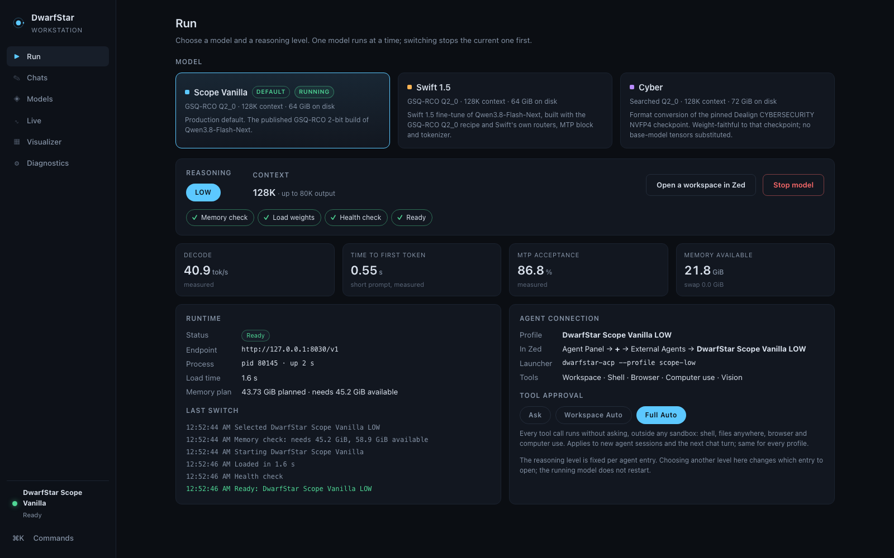
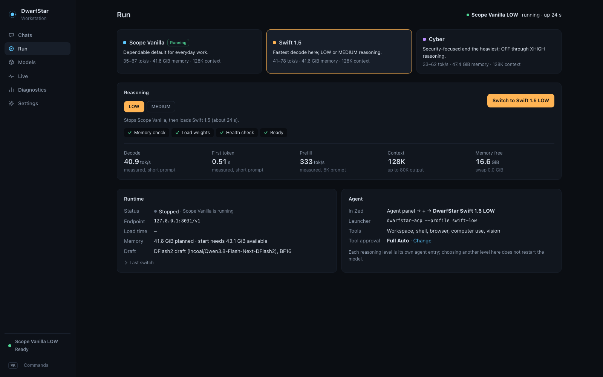
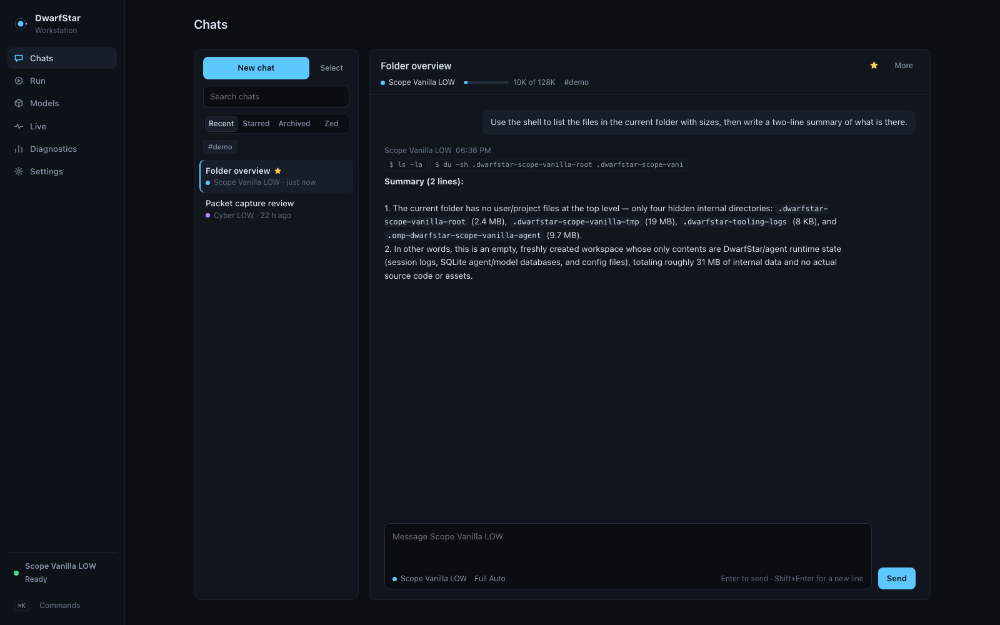
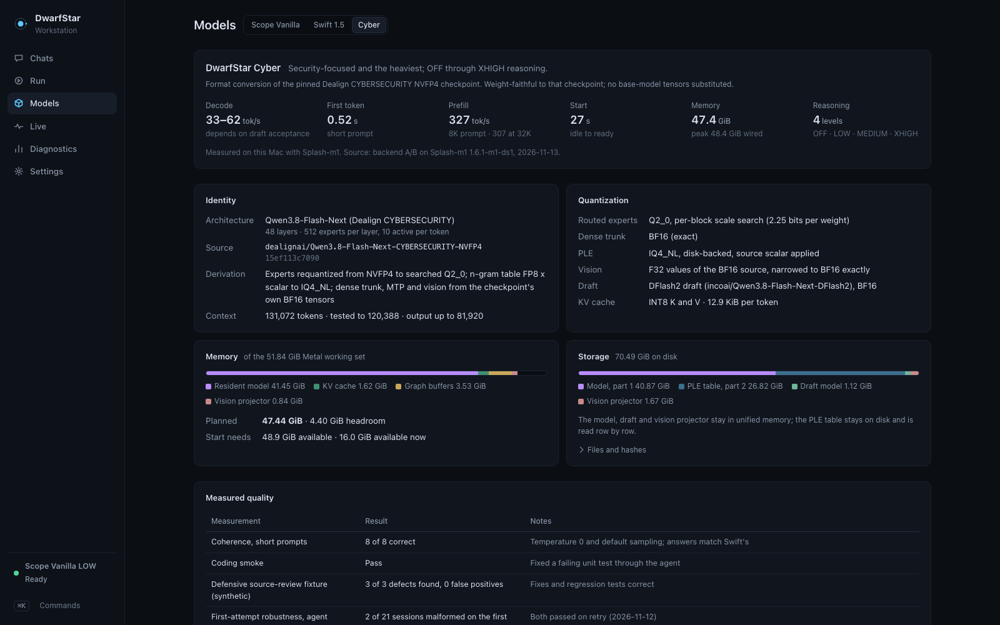
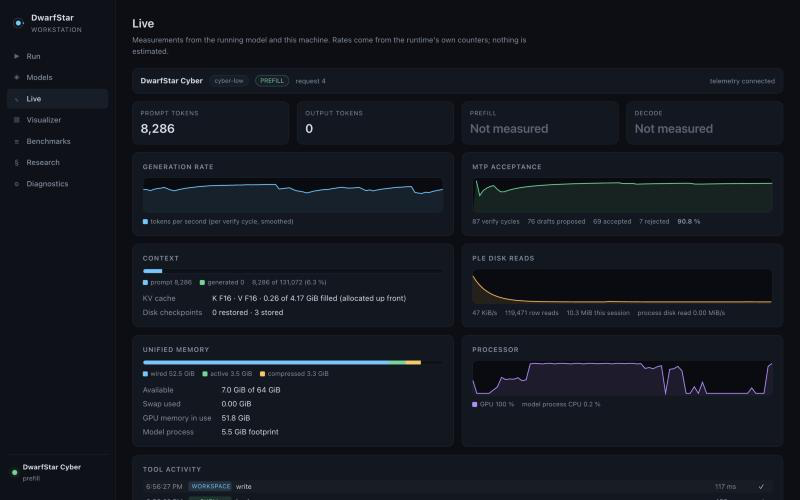
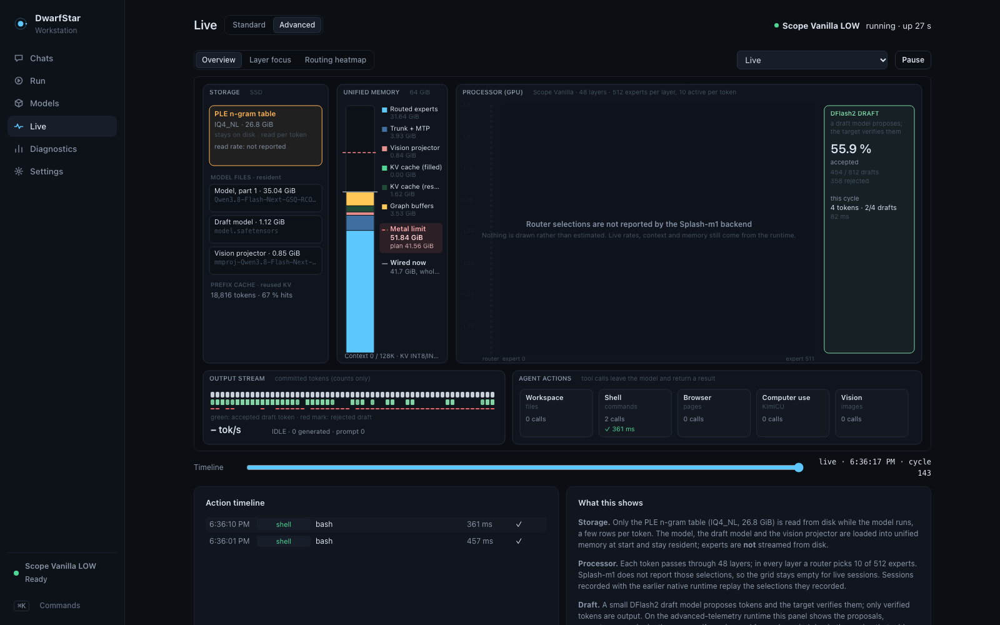
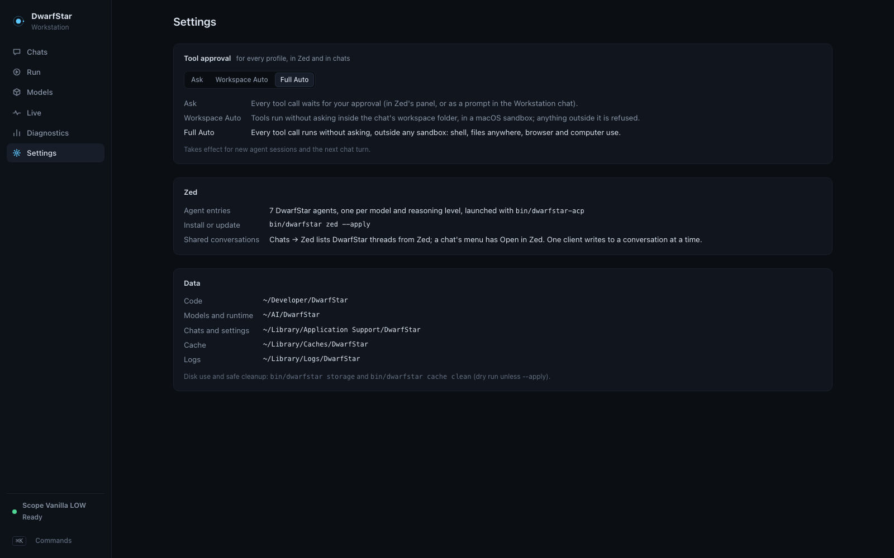

# Workstation

`DwarfStar Workstation.app` is a thin native window (Swift + WebKit, `app/workstation/Sources/main.swift`) around the local service. On launch it starts `bin/dwarfstar serve` if nothing answers on 127.0.0.1:8038, then shows the service's interface. All logic lives in the service, so the app, the command line and the tests behave identically.

## Views

| View | Contents |
|---|---|
| **Chats** | New chat (uses the model and reasoning chosen on Run), Recent / Starred / Archived, **folders** (see below), tag filters and search (titles, tags, messages, across every folder), pins (kept on top), stars, tags, inline rename (never overwritten by the automatic title), fork the whole chat or from any reply, new chat with the same settings, export as Markdown or JSON, select mode for bulk archive/restore/delete (deleting needs the count typed out; chats are moved aside, not erased), context used and left, compactions. Turns run through the same ACP agent as Zed and resume its session, so tools, the approval mode and the agent's automatic compaction apply; the full transcript is kept separately under `<data>/chats/` (never in Git). In Ask mode a tool call shows an approval card in the chat. Reasoning is not shown. The last chat reopens after a restart. |
| **Run** | Model selector (Scope Vanilla, Swift 1.5, Cyber), a reasoning selector that changes per model (the last level used with each model is remembered), the model's context as a fixed capability (128K for all three), launch/switch/stop with a stage row (stop current, memory check, load with a timer against the measured load time, health check, ready), a pre-switch summary when a running model or an answering chat would be interrupted, memory admission, key measured numbers, the matching Zed entry and the tool approval presets. |
| **Models** | One page per model with the same schema: a measured headline (decode, first token, prefill, start, memory, reasoning levels), then identity, quantization, memory composition and storage; runtime policy, capabilities and file hashes sit behind a disclosure. Anything not measured says **Not measured**. |
| **Live** | Two views, toggled at the top. **Standard**: the latest request (from the agent's own receipt), then Splash's running measurements since the model started — requests, time to first token, inter-token latency, prefill and decode rates, draft acceptance, prefix-cache hits — plus context, unified memory, thermal state, the processor and tool activity. **Advanced** is the former Visualizer (`docs/VISUALIZER.md`): a data map with a live per-verify-cycle DFlash2 draft panel (from the ds2 runtime's telemetry ring); what Splash does not report (router, experts, PLE) is labelled, never estimated. On the ds3 GPU-telemetry runtime (experiment, [DS3-GPU-TELEMETRY.md](DS3-GPU-TELEMETRY.md)) the processor region also draws router **aggregates** — per-layer routes over the last ~1.5 s, a layer × expert heatmap for the session or a viewed request (decode or prefill), the busiest experts and concentration per layer — with an optional **Sampled selections** switch (one decode step in N, no weights), a badge saying which, and the PLE row store's read rate, cache hits and latency. |
| **Diagnostics** | A status strip (model, reasoning, runtime, context, checks); one memory composition bar with system RAM, the admission requirement, the Metal limit and the measured peak; performance since the model started and system facts side by side; chats, approval mode, telemetry and the last recovery. "All passed" stands for every ready check (27 on a complete installation), with the full list and the data roots behind disclosures; a failing or optional-missing check surfaces in a Needs-attention panel. Refresh, Copy diagnostics (home paths as `~`) and Reconcile state. `bin/dwarfstar doctor` prints the same checks. |
| **Settings** | Tool approval (the three presets with their behaviour), the Zed agent entries and how to install them, shared Workstation/Zed conversations, About (version, runtime, build), the five data roots, and the chat trash. |
| **Setup** | The first-run guide. It opens on its own once on a new installation (setup never finished and no chats yet); later from Diagnostics → **Setup guide** or the setup banner. It walks the `doctor` checks by area (this Mac, software, folders and runtime, models, integrations) in green / yellow / red, each problem with its remedy: commands to copy, and for a missing model every expected file path and size. It reads only and never downloads; **Check again** re-runs the checks. Then it offers the tool approval presets (Full Auto keeps its confirmation) and **Finish** records that setup was seen (`setup_completed` in `<data>/state/workstation.json`). |

## Profiles

| Model | Reasoning | Context | K / V cache | Default |
|---|---|---:|---|---|
| Scope Vanilla | LOW | 128K | INT8 / INT8 | yes |
| Swift 1.5 | LOW, MEDIUM | 128K | INT8 / INT8 | no |
| Cyber | OFF, LOW, MEDIUM, XHIGH | 128K | INT8 / INT8 | no |

Changing reasoning on a running model never restarts it; the effort is carried per request by the agent's provider file. Swift LOW and MEDIUM keep separate session namespaces.

## Folders

Folders organize chats into projects: **Folders** in the chat sidebar lists them with counts (All chats, your folders, Unfiled). A folder can hold one level of subfolders (*Projects / DwarfStar*).

* **Create** with `+` (inside the selected top-level folder, or at the top); **Rename**, **New subfolder** and **Delete…** appear under the list when a folder is selected.
* **Move** a chat with *Move to folder…* in its menu, with *Move to folder…* in Select mode for several at once, or by dragging it onto a folder.
* **Selecting a folder** shows its chats and its subfolders' chats; a **search** looks in every folder and shows each result's folder.
* **Deleting a folder never deletes a chat:** its chats (archived ones too) become Unfiled; deleting a folder with subfolders says so and removes them with it.
* A folder is organization only. Moving a chat does not change its agent session, workspace, transcript, model or place in Recent, so a chat shared with Zed resumes in either client exactly as before. A fork starts in its original's folder; archiving keeps the folder, so an unarchived chat is back where it was. Tags stay separate: one folder, any number of tags.

**Deleted chats** go to the chat trash (`<data>/chats/.deleted`) and stay recoverable until you empty it, from **Settings → Deleted chats** (typed confirmation) or `bin/dwarfstar storage --empty-chat-trash --apply`. Nothing is removed on a timer.

## Tool approval

| Preset | Behaviour |
|---|---|
| **Ask** | Every tool call waits for approval: in Zed's panel, or as an approval card in the Workstation chat (declined after 10 minutes). |
| **Workspace Auto** | Tools run without asking inside the session's workspace folder, in a macOS sandbox; anything outside it is refused. |
| **Full Auto** | Every tool call runs without asking, outside any sandbox. Turning it on always needs an explicit confirmation. |

The preset is installation-wide (`<data>/config/approval.json`), applies to new agent sessions and the next chat turn, and is the same for every profile, in the Workstation and in Zed (both start the agent through `bin/dwarfstar-acp`). It is set on the **Settings** page or from the Run page's agent panel, and the composer and Run page always show it. A fresh installation starts in Workspace Auto; Full Auto is entered only by an explicit confirmation and then stays until it is changed, across restarts. A Workspace Auto agent cannot raise its own preset: its sandbox can write only inside its workspace (not `approval.json`) and cannot connect to the Workstation service's port. macOS's own permission prompts (screen recording, accessibility) are separate and always apply.

### Local service exposure

The Workstation service (port 8038, `DWARFSTAR_HTTP_PORT`), the telemetry event socket (UDP 8039, `DWARFSTAR_TELEMETRY_PORT`) and every model server bind `127.0.0.1` only, so nothing is reachable from the network. The service also answers only requests whose `Host` is `127.0.0.1` or `localhost` and, when a browser sends an `Origin`, only a loopback origin, which stops another web page (or a DNS-rebinding name) from driving it. Static files are served only from the app's web folder. `/api/telemetry` carries numeric timings and counters and no prompt or reply text. Copied diagnostics write home paths as `~`.

## Shared conversations with Zed

A DwarfStar conversation's agent session file is one canonical record, and both clients drive the same ACP agent, so a conversation can move between the Workstation and Zed:

* **Chats → Zed tab** lists the DwarfStar threads in Zed's agent panel (read from Zed's database, never written). A thread whose workspace is still present and whose profile is current can be **continued** in the Workstation on the same agent session — nothing is copied; one whose workspace was archived or whose profile is retired can be **read**.
* A chat's **Open in Zed** opens its workspace in Zed, where the matching DwarfStar agent lists the session in its history (ACP `session/list` → `session/load`).
* One client writes to a conversation at a time. If Zed holds it open, the Workstation says so and does not fork; it never starts a second session silently. Reasoning is never shown in the Workstation, even where Zed stores it in the session file. See `docs/SESSIONS.md`.

## Recovery

When the service starts, and on **Reconcile state** in Diagnostics, saved state is compared with the real processes; nothing is ever signalled. A ledger whose process has exited is retired; a ledger whose PID now belongs to another program is retired without touching that program; a running server whose command line is exactly this model's generated one but has no ledger (the service or controller died during a start) is health-checked and adopted, so the Workstation reconnects instead of starting a second copy; any other model server is reported as foreign. A chat whose transcript ends with an unanswered message is marked interrupted (its agent session is intact; send again to continue), and telemetry sessions left open by a crash are closed.

## Memory admission

Before a start the controller applies one shared formula (`config/runtime-policy.json`): planned = resident model + KV + graph buffers + vision projector; required = planned + a 1.5 GiB system reserve. Requirements today: Scope 45.2 GiB, Swift 45.2 GiB, Cyber 52.3 GiB. Separately, a plan larger than the GPU's Metal working set (measured live, 51.84 GiB on an M1 Max 64 GiB) is refused, because it would fail at depth even with free memory. A refusal names the model, both numbers and what to do, and nothing is started. When another model is running the UI accounts for the memory the switch will free.

## Building and installing

```bash
python3 app/workstation/build.py --bundle "$HOME/Applications/DwarfStar Workstation.app"
```

The bundle records the repository path; it contains no model data or user settings. The build refuses to overwrite an existing bundle.

## Command line equivalents

```bash
bin/dwarfstar switch swift-medium     # what the Launch button does
bin/dwarfstar state                   # selection and per-model status
bin/dwarfstar stop-all
bin/dwarfstar runtime --model cyber requirement
```

## Screenshots

| | |
|---|---|
|  Run: Scope selected and running |  Swift 1.5 with LOW / MEDIUM |
|  A chat with Cyber LOW using the shell tool | |
|  Cyber model page |  Live, standard view: Splash's own measurements |
|  Live, advanced view: data map with unreported regions labelled |  Settings: approval, Zed and data roots |
