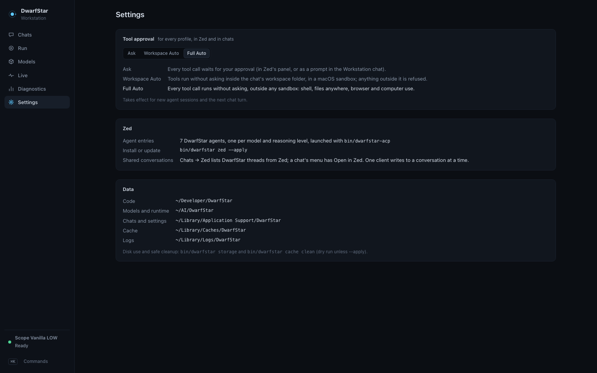

# Workstation

`DwarfStar Workstation.app` is a thin native window (Swift + WebKit, `app/workstation/Sources/main.swift`) around the local service. On launch it starts `bin/dwarfstar serve` if nothing answers on 127.0.0.1:8038, then shows the service's interface. All logic lives in the service, so the app, the command line and the tests behave identically.

## Views

| View | Contents |
|---|---|
| **Chats** | New chat (uses the model and reasoning chosen on Run), Recent / Starred / Archived, tag filters and search (titles, tags, messages), pins (kept on top), stars, tags, inline rename (never overwritten by the automatic title), fork the whole chat or from any reply, new chat with the same settings, export as Markdown or JSON, select mode for bulk archive/restore/delete (deleting needs the count typed out; chats are moved aside, not erased), context used and left, compactions. Turns run through the same ACP agent as Zed and resume its session, so tools, the approval mode and the agent's automatic compaction apply; the full transcript is kept separately under `<data>/chats/` (never in Git). In Ask mode a tool call shows an approval card in the chat. Reasoning is not shown. The last chat reopens after a restart. |
| **Run** | Model selector (Scope Vanilla, Swift 1.5, Cyber), a reasoning selector that changes per model (the last level used with each model is remembered), the model's context as a fixed capability (128K for all three), launch/switch/stop with a stage row (stop current, memory check, load with a timer against the measured load time, health check, ready), a pre-switch summary when a running model or an answering chat would be interrupted, memory admission, key measured numbers, the matching Zed entry and the tool approval presets. |
| **Models** | One page per model with the same schema: a measured headline (decode, first token, prefill, start, memory, reasoning levels), then identity, quantization, memory composition and storage; runtime policy, capabilities and file hashes sit behind a disclosure. Anything not measured says **Not measured**. |
| **Live** | Two views, toggled at the top. **Standard**: the latest request (from the agent's own receipt), then Splash's running measurements since the model started — requests, time to first token, inter-token latency, prefill and decode rates, draft acceptance, prefix-cache hits — plus context, unified memory, thermal state, the processor and tool activity. **Advanced** is the former Visualizer (`docs/VISUALIZER.md`): a data map with a live per-verify-cycle DFlash2 draft panel (from the ds2 runtime's telemetry ring); what Splash does not report (router, experts, PLE) is labelled, never estimated. |
| **Diagnostics** | A status strip (model, reasoning, runtime, context, checks); one memory composition bar with system RAM, the admission requirement, the Metal limit and the measured peak; performance since the model started and system facts side by side; chats, approval mode, telemetry and the last recovery. "All passed" stands for 26 ready checks, with the full list and the data roots behind disclosures; a failing or optional-missing check surfaces in a Needs-attention panel. Refresh, Copy diagnostics (home paths as `~`) and Reconcile state. `bin/dwarfstar doctor` prints the same checks. |
| **Settings** | Tool approval (the three presets with their behaviour), the Zed agent entries and how to install them, shared Workstation/Zed conversations, and the five data roots. |

## Profiles

| Model | Reasoning | Context | K / V cache | Default |
|---|---|---:|---|---|
| Scope Vanilla | LOW | 128K | INT8 / INT8 | yes |
| Swift 1.5 | LOW, MEDIUM | 128K | INT8 / INT8 | no |
| Cyber | OFF, LOW, MEDIUM, XHIGH | 128K | INT8 / INT8 | no |

Changing reasoning on a running model never restarts it; the effort is carried per request by the agent's provider file. Swift LOW and MEDIUM keep separate session namespaces.

## Tool approval

| Preset | Behaviour |
|---|---|
| **Ask** | Every tool call waits for approval: in Zed's panel, or as an approval card in the Workstation chat (declined after 10 minutes). |
| **Workspace Auto** | Tools run without asking inside the session's workspace folder, in a macOS sandbox; anything outside it is refused. |
| **Full Auto** | Every tool call runs without asking, outside any sandbox. Turning it on always needs an explicit confirmation. |

The preset is installation-wide (`<data>/config/approval.json`), applies to new agent sessions and the next chat turn, and is the same for every profile. It is set on the **Settings** page or from the Run page's agent panel. macOS's own permission prompts (screen recording, accessibility) are separate and always apply.

## Shared conversations with Zed

A DwarfStar conversation's agent session file is one canonical record, and both clients drive the same ACP agent, so a conversation can move between the Workstation and Zed:

* **Chats → Zed tab** lists the DwarfStar threads in Zed's agent panel (read from Zed's database, never written). A thread whose workspace is still present and whose profile is current can be **continued** in the Workstation on the same agent session — nothing is copied; one whose workspace was archived or whose profile is retired can be **read**.
* A chat's **Open in Zed** opens its workspace in Zed, where the matching DwarfStar agent lists the session in its history (ACP `session/list` → `session/load`).
* One client writes to a conversation at a time. If Zed holds it open, the Workstation says so and does not fork; it never starts a second session silently. Reasoning is never shown in the Workstation, even where Zed stores it in the session file. See `docs/SESSIONS.md`.

## Recovery

When the service starts, and on **Reconcile state** in Diagnostics, saved state is compared with the real processes; nothing is ever signalled. A ledger whose process has exited is retired; a ledger whose PID now belongs to another program is retired without touching that program; a running server whose command line is exactly this model's generated one but has no ledger (the service or controller died during a start) is health-checked and adopted, so the Workstation reconnects instead of starting a second copy; any other model server is reported as foreign. A chat whose transcript ends with an unanswered message is marked interrupted (its agent session is intact; send again to continue), and telemetry sessions left open by a crash are closed.

## Memory admission

Before a start the controller applies one shared formula (`config/runtime-policy.json`): planned = resident model + KV + graph buffers + vision projector; required = planned + a 1.5 GiB system reserve. Requirements today: Scope 45.2 GiB, Swift 45.2 GiB, Cyber 52.3 GiB. Separately, a plan larger than the GPU's Metal working set (measured live, 51.84 GiB on an M1 Max 64 GiB) is refused, because it would fail at depth even with free memory. A refusal names the model, both numbers and what to do, and nothing is started. When another model is running the UI accounts for the memory the switch will free.

## Building and installing

```bash
python3 app/workstation/build.py --bundle "$HOME/Applications/DwarfStar Workstation.app"
```

The bundle records the repository path; it contains no model data or user settings. The build refuses to overwrite an existing bundle.

## Command line equivalents

```bash
bin/dwarfstar switch swift-medium     # what the Launch button does
bin/dwarfstar state                   # selection and per-model status
bin/dwarfstar stop-all
bin/dwarfstar runtime --model cyber requirement
```

## Screenshots

| | |
|---|---|
|  Run: Scope selected and running |  Swift 1.5 with LOW / MEDIUM |
|  A chat with Cyber LOW using the shell tool | |
|  Cyber model page |  Live, standard view: Splash's own measurements |
|  Live, advanced view: data map with unreported regions labelled |  Settings: approval, Zed and data roots |
