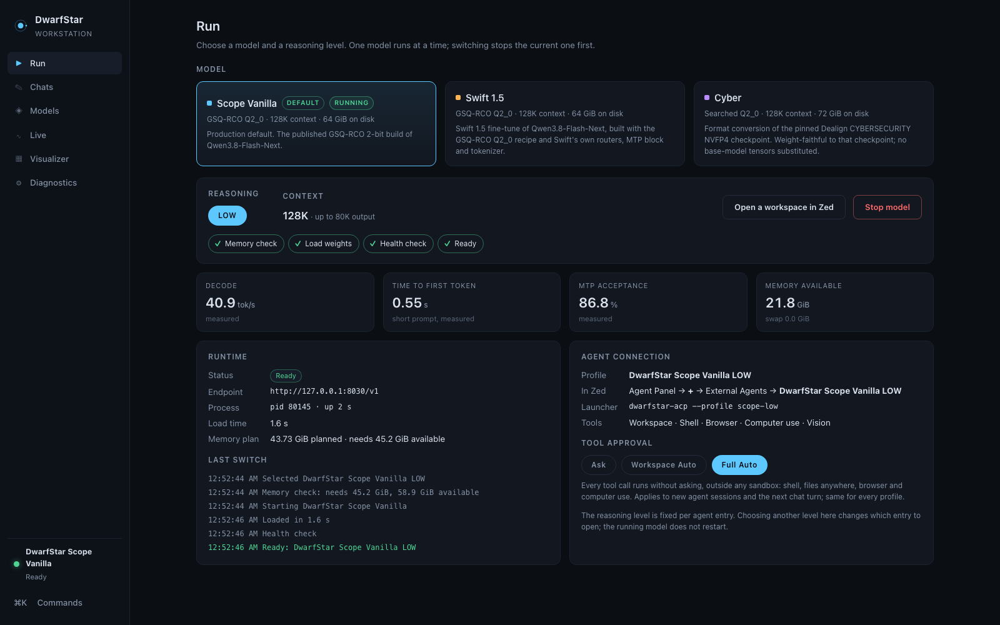
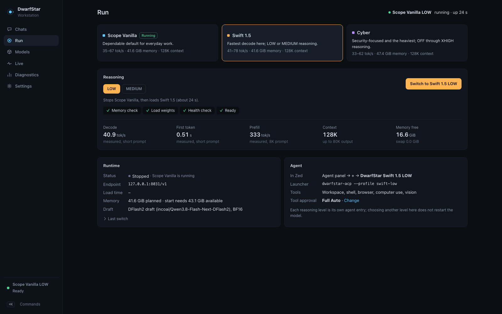
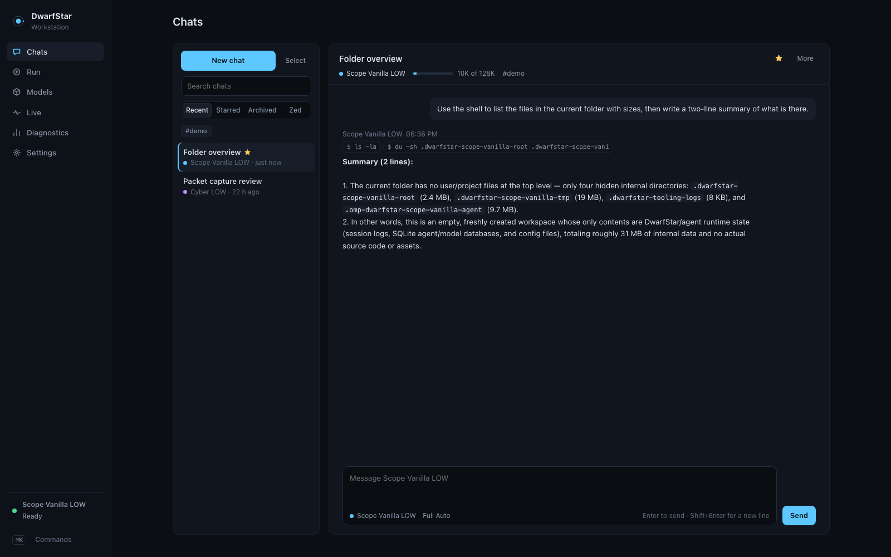
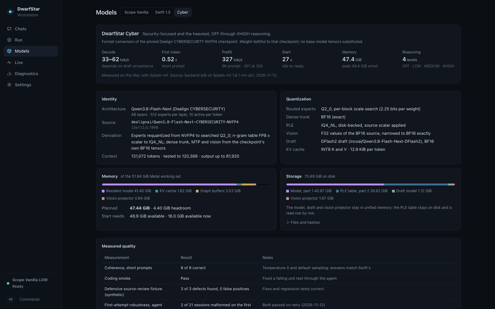
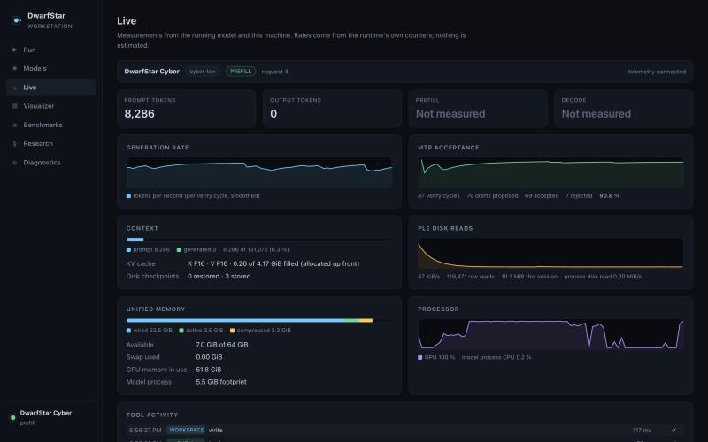
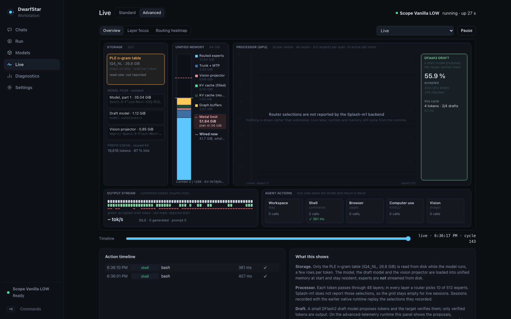

# Workstation

`DwarfStar Workstation.app` is a thin native window (Swift + WebKit, `app/workstation/Sources/main.swift`) around the local service. On launch it starts `bin/dwarfstar serve` if nothing answers on 127.0.0.1:8038, then shows the service's interface. All logic lives in the service, so the app, the command line and the tests behave identically.

## Views

| View | Contents |
|---|---|
| **Chats** | New chat (uses the model and reasoning chosen on Run), recent and archived lists, search, inline rename (never overwritten by the automatic title), archive/unarchive, two-step delete, timestamps, model/reasoning and context usage per chat. Turns run through the same ACP agent as Zed and resume its session, so tools, Full Auto and the agent's automatic compaction apply; the full transcript is kept separately under `<data>/chats/` (never in Git). Reasoning is not shown. |
| **Run** | Model selector (Scope Vanilla, Swift 1.5, Cyber), a reasoning selector that changes per model, the model's context as a fixed capability (128K for all three), launch/switch/stop, memory admission, key measured numbers and the matching Zed entry. |
| **Models** | One statistics page per model with the same schema: identity, source and revision, quantization, storage, memory plan, context and KV cache dtypes, speed, MTP, capabilities, provenance, and quality/benchmark history. Anything not measured says **Not measured**. |
| **Live** | Prompt/output tokens, prefill and decode rates, MTP acceptance, context occupancy, PLE disk reads, unified memory, GPU and the tool activity of the running session. |
| **Visualizer** | See `docs/VISUALIZER.md`. |
| **Diagnostics** | Generated-config drift, Zed entry check, seal presence, telemetry hub state, server logs, code and data roots. |

## Profiles

| Model | Reasoning | Context | K / V cache | Default |
|---|---|---:|---|---|
| Scope Vanilla | LOW | 128K | F16 / F16 | yes |
| Swift 1.5 | LOW, MEDIUM | 128K | F16 / F16 | no |
| Cyber | OFF, LOW, MEDIUM, XHIGH | 128K | F16 / F16 | no |

Changing reasoning on a running model never restarts it; the effort is carried per request by the agent's provider file. Swift LOW and MEDIUM keep separate session namespaces.

## Memory admission

Before a start the controller applies one shared formula (`config/runtime-policy.json`): planned = resident model + KV + graph buffers + vision projector; required = planned + a 1.5 GiB system reserve. Requirements today: Scope 45.2 GiB, Swift 45.2 GiB, Cyber 52.3 GiB. Separately, a plan larger than the GPU's Metal working set (measured live, 51.84 GiB on an M1 Max 64 GiB) is refused, because it would fail at depth even with free memory. A refusal names the model, both numbers and what to do, and nothing is started. When another model is running the UI accounts for the memory the switch will free.

## Building and installing

```bash
python3 app/workstation/build.py --bundle "$HOME/Applications/DwarfStar Workstation.app"
```

The bundle records the repository path; it contains no model data or user settings. The build refuses to overwrite an existing bundle.

## Command line equivalents

```bash
bin/dwarfstar switch swift-medium     # what the Launch button does
bin/dwarfstar state                   # selection and per-model status
bin/dwarfstar stop-all
bin/dwarfstar runtime --model cyber requirement
```

## Screenshots

| | |
|---|---|
|  Run: Scope selected and running |  Swift 1.5 with LOW / MEDIUM |
|  A chat with Cyber LOW using the shell tool | |
|  Cyber statistics page |  Live telemetry during a Cyber agent session |
|  Visualizer: router, MTP, PLE, shell action | |
